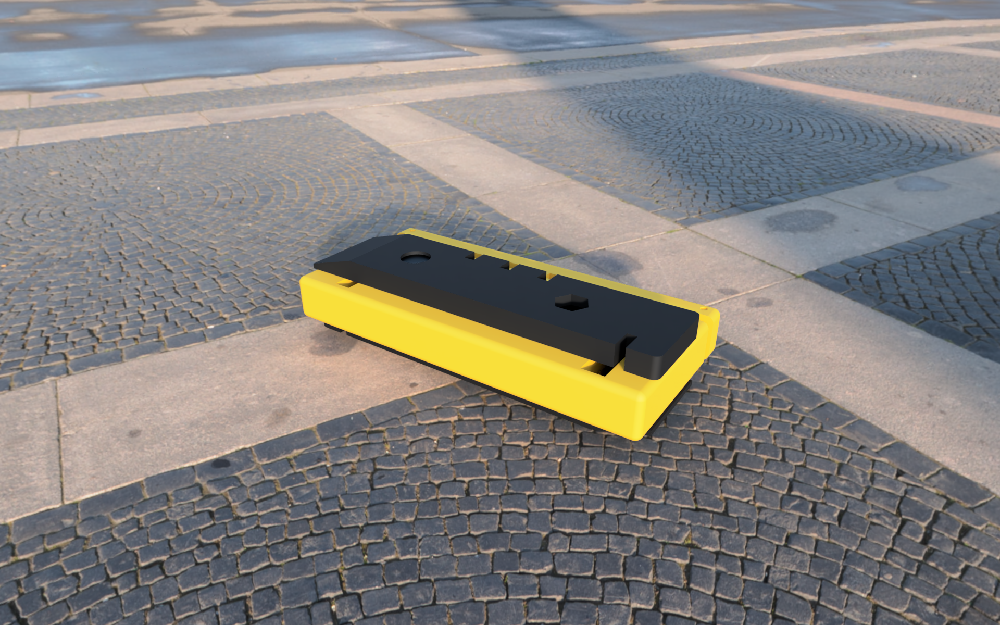
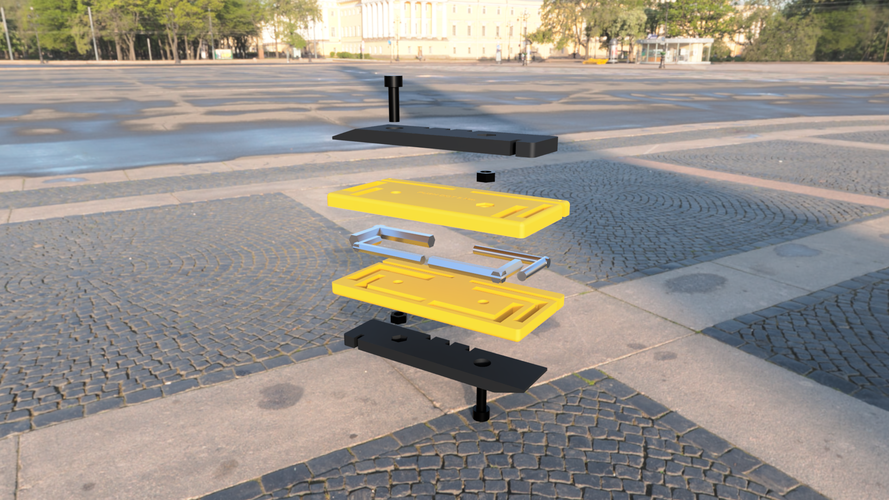
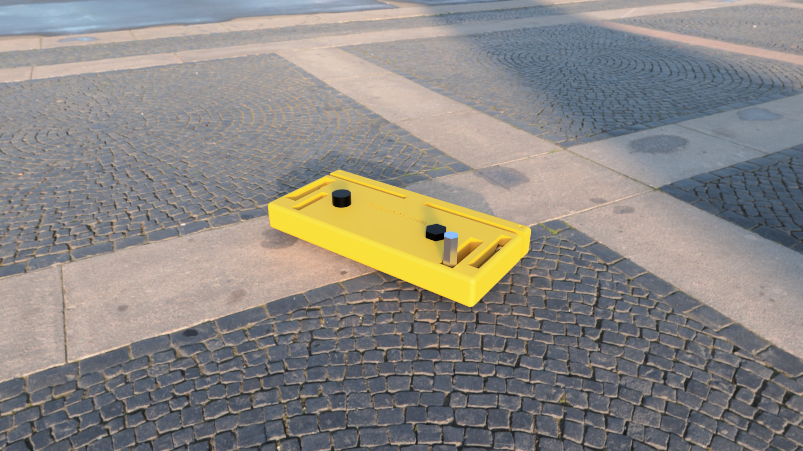

# Pocket Flat & Bolt Kit (PFBK) — v0.1

> ⚠️ **v0.1. Not meant to replace professional bike shop tools.**
> Its static stress study has **not** been run yet (see `sim/README.md`). Use at your own risk.

A jersey-pocket roadside kit for a **flat tire** and a **loose bolt**: four steel L-keys (4, 5, 6 mm hex and T25 Torx) swing out of a
3D-printed PETG clamshell body, with a 5 N·m torque indicator, two nesting tire levers and a 3-size spoke-nipple wrench.
Designed parametrically in Autodesk Fusion. Every dimension is driven by one of 85 named user parameters.





## Status
| Item | State |
|---|---|
| Research with citations | ✅ `research/sources.md` (unverified items listed) |
| Parametric CAD (Fusion) | ✅ `cad/PFBK_v0.1.f3d`, `cad/parameters.csv` |
| Model checks | ✅ 0 interference, fold sweep clear, min wall 1.87 mm, max overhang 45° (`docs/checks.md`) |
| Static stress study (FEA) | ❌ **Not run. Deferred to v0.2** (designer decision; the Fusion API was blocked, see `sim/README.md`). v0.1 relies on the hand-calc ESTIMATE, min SF 2.01 |
| STL / STEP | ✅ print-oriented STLs, per-part and assembly STEP |
| Slicing | ✅ Bambu Studio CLI, X1C, PETG: kit ≈ 2 h 23 min, 71.3 g, no supports (`slicing/README.md`) |

## Bill of materials
**Print (PETG):** `stl/PFBK_v0.1_body_top.stl` ×1 · `stl/PFBK_v0.1_body_bottom.stl` ×1 · `stl/PFBK_v0.1_tire_lever_print_x2.stl` ×2
(STLs are already in print orientation, flat face down, no supports. 0.20 mm layers, 5 walls, 40 % gyroid.)

**Buy:**
| Part | Qty | Note |
|---|---|---|
| Hex L-key 4 mm, 5 mm, 6 mm | 1 each | cut the long arm to **40.5 / 37.6 / 36.7 mm**, measured from the outside of the short arm |
| Torx T25 L-key (Ø4.5 mm blade) | 1 | cut the long arm to **38.7 mm** |
| M5×16 socket head cap screw, ISO 4762 | 2 | tightened with the kit's own 4 mm key |
| M5 hex nut (8 mm A/F) | 2 | sits in the 1 mm hex recess |

## Assembly (v0.1)
1. Cut and deburr the key long arms to the lengths above.
2. Lay the four keys in the bottom half's bore grooves, short arms folded into their slots. The 6 mm key and 4 mm key go at one end, T25 and 5 mm at the other.
3. Close the top half. Fit screw 1 head-up at one end and screw 2 head-down at the other (each nut in the hex recess on the opposite face). Tighten snugly. No torque spec is given for this joint (not sourced).
4. Press the two levers onto the faces: the round hole goes over a screw head, the hex hole over a nut. With the levers on, the keys cannot swing out.

**Use:** remove the levers, swing a key 90° out of either face, turn the body as the handle. **Torque indicator:** push only on an engraved
dot. When the beam closes its gap against the body you are at ≈5 N·m (hand-calculated, **not calibrated**).

## Resizing
Open the `.f3d` and edit user parameters (`T_design`, `sf_target`, key sizes, `pivot_clear`, `ind_torque`, …). Embedded key lengths,
body length and width, bore shape, beam thickness and screw recess are all derived expressions. Sources and labels for each parameter are in
`docs/scope.md` and `cad/parameters.csv`.

## Repository layout
```
cad/        Fusion archive (.f3d) + parameters.csv
stl/        print-ready STLs + assembly STL
step/       per-part and assembly STEP
renders/    3 Fusion local renders (packed, exploded, in use)
docs/       scope.md · design_rationale.md · checks.md · check/ screenshots
sim/        README.md (stress study status + planned load case) · hand_calculation.md (ESTIMATE)
slicing/    Bambu Studio results per part + flattened profiles
research/   sources.md (every cited value + what could not be verified)
graphify-out/  knowledge graph of the project docs (graph.html, GRAPH_REPORT.md)
```

## License
© 2026 the author. Licensed under **Creative Commons Attribution 4.0 International (CC BY 4.0)**. See [LICENSE](LICENSE) and
https://creativecommons.org/licenses/by/4.0/. You may share and adapt it, including commercially, with attribution.

## Disclaimer
This design is provided **"as is", without warranty of any kind**. It is a **v0.1** student portfolio project and is **not meant to replace
professional bike shop tools** or a calibrated torque wrench. Bolt torques come from published manufacturer values compiled by
Park Tool; always follow your component manufacturer's specification. Incorrect torque can damage parts or cause a crash. The author accepts no
liability for any damage or injury arising from its use.
